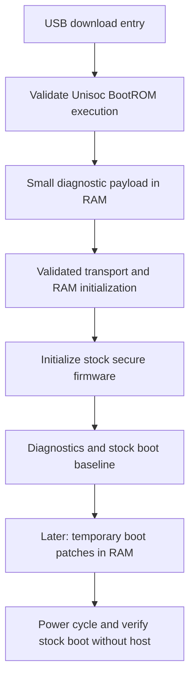

# ZTE W202DS — Bootloader Unlock Procedure

> **HISTORICAL DRAFT — superseded 2026-10-21.**
> The persistent unlock is now verified. Use
> [`persistent-unlock-W202DS.md`](persistent-unlock-W202DS.md) for the
> current procedure. The executive summary and open questions below describe
> the pre-persistence research state and are kept for provenance only.
>
> **Repository note:** the companion `bootloader/...` paths below refer to the
> original working tree. Not all of those files are included in this
> repository.

Status: **historical draft, last updated 2026-10-17**. Distinguishes what was
*verified* from what was *unproven* at that time. Do not use this as the current
recipe.

**Latest live result (2026-10-17):** the user's key-combination trial received
`SPRD3\0`, the upstream-identified BootROM banner, with independently verified
CRC16 `0x570a`. Route A now has verified BootROM protocol access without an SPL
erase. Loader/exploit execution is still untested. See
`analysis/keycombo-sprd3-result-2026-10-17.md` and its preserved raw log.

Companion documents (read these first):

- `bootloader/analysis/README.md` — bootloader RE notes, tool anatomy, patch recipes.
- `bootloader/analysis/fdl1-exec-review-2026-10-17.md` — verified FDL1 BLR call and stock LK autoloader emulation; supersedes the earlier route B proposal below.
- `bootloader/analysis/lock-verification-2026-10-15.md` — consolidated verification report.
- `bootloader/analysis/secure-lock-services-2026-10-15.txt` — TrustOS 0x31/0x33 disassembly.
- `bootloader/docs/ram-payload-design-W202DS.md` — RAM-test payload entry-path analysis (step 1) + payload design (step 2).
- Upstream wiki: https://github.com/TomKing062/CVE-2022-38694_unlock_bootloader/wiki

---

## 0. Executive summary

| Question | Answer | Confidence |
|---|---|---|
| Is the lock stored in an eFuse? | **No** — it is a record in the `miscdata` partition | verified |
| Where is the record? | `miscdata` byte offset `0x2000`, length `0x1dc` (476 B) | verified |
| What decides lock vs unlock? | 64-byte token at `record[0:0x40]`, compared in secure world | verified |
| Can the stock writer unlock? | **No** — `set_lock_status` rejects `arg==1` in both slots | verified |
| Can the stock reader recognize unlock? | **Yes** — it accepts a valid `VerifiedBoot-UNLOCK` token | verified |
| Is a persistent unlock possible? | **Plausibly** — a valid token can be produced via SMC service `0x31` | unproven on hardware |
| Lock record on this device? | `miscdata@0x2000` = **64 zero bytes** = locked | **verified on hardware** |
| Can the pack's CVE chain fire through `SPRD4:AutoD`? | **No through the traced host/stock path** — its internal protocol phases skip the release loader prefix | source and hardware evidence |
| Is BootROM protocol entry reachable without an SPL erase? | **Yes** — key-combination trial returned `SPRD3\0`, CRC16 `0x570a` | **verified on hardware**; exploit/loader compatibility still untested |
| Is the whole thing proven on hardware? | **No** — RAM execution not yet achieved | — |

**Recovery baseline:** a full read-only dump of all 76 GPT partitions + splloader
+ pgpt (**8.57 GiB, including `super`**) was taken 2026-10-17. Hash-verified
(83/83 OK) and live re-read verified (65/77 byte-identical; rest are
runtime-volatile). See `backups/2026-10-17-full/`.

**Hard gate:** establishing an actual device path for custom RAM execution.
Static analysis of both stock LK slots now shows that the apparent FDL1 stage
only ACKs data packets and switches to an internal LK service on EXEC. A custom
host alone (the earlier route B proposal) cannot load an image through these
handlers. Route A now has verified BootROM protocol access (`SPRD3`); actual
exploit/loader execution and a bounded payload experiment remain unproven.
See §0.2 and the latest live result above.

### 0.1 Selected approach: host-driven RAM boot

Use the staged architecture of checkm8/checkra1n as the research guideline:
establish a BootROM execution primitive, run a small pre-boot environment in
RAM, and then hand off to the device's boot chain. The first implementation
target is temporary RAM execution. Writing a persistent unlock record (§6–§8)
is a separate optional branch, rather than the automatic next phase.



This is a proposed sequence, not a working command chain. The compatible
downloadable loader or alternate transport path remains missing, and the
BootROM payload has not been executed on this W202DS.
The known signed download path and USB ID alone do not establish control of
the actual BootROM; identify which boot stage currently serves the USB protocol.

| Stage | Evidence required before advancing |
|---|---|
| BootROM execution | A deliberately minimal payload returns a known marker or host challenge; USB enumeration alone is insufficient. |
| RAM transport | A validated loader or stub accepts a bounded test buffer and verifies its contents in known-safe memory; SPL and FDL1 roles stay distinct. |
| Secure firmware | Correct SML/TrustOS/teecfg placement and initialization, established before attempting their SMC services. |
| RAM diagnostics | Once the TEE is ready, generate a candidate token with service 0x31 and check it with 0x33 in RAM; an outer 0x31 success alone is insufficient. No record is written. |
| Stock boot baseline | Hand off to stock images, observe the boot state, and compare fresh protected-state baselines. |
| Temporary boot | Audit the selected memory patches and demonstrate the intended boot behavior. A cold boot without the host must select the stock chain again; stored image and lock-record changes are excluded from this branch. |

The role played by PongoOS on Apple can be filled here by a small device-specific
loader/stub or a validated LK-based environment. Apple payloads, USB requests,
board drivers, and PongoOS binaries cannot simply be reused for Unisoc.

| role | checkm8 / checkra1n | this project (Unisoc ums9620) |
|---|---|---|
| exploit primitive | checkm8 — BootROM memory corruption in the USB DFU path; **per‑boot** | **CVE-2022-38694** — BootROM memory corruption (overwrite a data‑section function pointer or a stack return address); runs with BootROM privileges; **one‑time** |
| host arrangement | crafted DFU control transfers | `exec_addr` places `custom_exec_no_verify_<addr>.bin` at a chosen address and drives `BSL_CMD_EXEC_DATA` (`spd_dump`, "brom stage only") |
| pre‑boot environment | **PongoOS** — sets up clocks/MMU, then loads the payload | **to be built** — a device‑specific loader/stub (or validated LK environment) that brings up DDR/MMU and the secure firmware, then hands off |
| persistence | tethered / per‑boot | RAM branch = per‑boot; persistent unlock (§6) is a separate branch |

Two boundaries matter for this analogy:

- `exec_addr` is a **host-tool command**, not a documented ROM feature that
  intentionally permits unverified execution. The CVE-2022-38694 project
  describes overwriting a BootROM function pointer or stack return address.
  Its exploitation and resulting bypass must be validated for this device.
- Code residing in RAM can still write storage. Excluding persistent boot-image
  changes and lock-record writes requires auditing the payload's behavior.
  Stock Android may make ordinary data/log writes after boot; a RAM boot is
  not a claim that every flash byte remains unchanged. The checkra1n FAQ also
  describes installed third-party software that remains present after a normal
  reboot, so the jailbreak as a whole is not a zero-write reference.

Primary references: [PongoOS](https://github.com/checkra1n/PongoOS),
[checkra1n FAQ](https://checkra.in/#frequently-asked-questions),
[Unisoc exploit project](https://github.com/TomKing062/CVE-2022-38694_unlock_bootloader).

**Persistence, precisely.** Upstream describes CVE-2022-38694 as a *one-time*
signature-verification bypass and points to **CVE-2022-38691/38692** for a
*persistent* one. That is the same axis as our two branches, but the mechanisms
differ: the RAM branch here is per-boot (checkra1n-like), whereas Option A (§6)
is persistent because it writes a valid `miscdata` unlock record — **not**
because it makes signature verification persistently bypassable. Keep the two
ideas separate.

### 0.2 Protocol flow — the five beats (corrected 2026-10-17; updated with release pack)

**Static correction (2026-10-17):** the release-pack `fdl1-dl.bin` calls
downloaded code with `BLR X19` at `0x6500b064`, targeting download base +
`0x200`, with return address `0x6500b068`. It is different from the phone's
stock `SPRD4:AutoD` implementation. In both stock LK slots, autoloader
START/MIDST/END are ACK-only handlers; EXEC at `0xb50203cc` first emulates a
ROM reply, then calls internal LK download code at `0xb5013464`. It never
branches to a supplied image. Earlier change-log entries proposing a custom BSL
host for route B are superseded by this trace. See
`analysis/fdl1-exec-review-2026-10-17.md` and its reproducer.

The CVE-2022-38694 exploit path, when all pieces exist, is five beats:

| beat | what happens | state |
|---|---|---|
| 1 | **Enter download mode** — `adb reboot autodloader` (or POWER+VOL_DOWN held 7–10 s) → device enumerates as `1782:4d00` | **confirmed on hardware 2026-10-17** — Android drops in ~2 s, device shows up as `1782:4d00` in ~8 s; full read-only dump taken the same day (row (r)). Key-combo variant still untested. |
| 2 | **Open BSL session** — HDLC transport; `spd_dump` talks to the autoloader stage (`SPRD4:AutoD`) | tooling ready; the release pack (`…_9620_autodl`) is **built for this stage** |
| 3 | **Transfer #1: exploit data** — the 96-byte return-address chain lands on BROM's stack at `0x65012f48`; the overflow happens *during this transfer* | **artifact exists** (`custom_exec_no_verify_65012f48.bin`); byte-identical in release pack and repo (sha256 `3842a807…`) |
| 4 | **Transfer #2 + exec** — the intended BROM chain sends `fdl1-dl.bin` to `0x65000800`, followed by `fdl2-dl.bin` at `0xb4fffe00` | **loaders shipped; call traced offline** — packaged FDL1 uses `BLR X19` to download base + `0x200`. This chain remains unexecuted on W202DS. |
| 5 | **Download command service** — a real FDL1 can enter the next image; W202DS's reachable autoloader instead switches between internal LK protocol phases | Stock read service confirmed; session 1's read-only probes remain packaged. A subsequent `fdl`/`exec` cannot run `ramtest` through the traced stock autoloader handlers. |

The release batch line for the intended RAM prefix (FDL1 in SRAM, FDL2 in DRAM):

```
spd_dump --wait 300 exec_addr 0x65012f48 \
  fdl fdl1-dl.bin 0x65000800 \
  fdl fdl2-dl.bin 0xb4fffe00 \
  exec …
```

> **W202DS reality check (2026-10-17; see row (s)).** The trigger this device
> accepts presents the **autoloader** stage (`SPRD4:AutoD`). `spd_dump`
> auto-brings-up that stage's **built-in** FDL1/FDL2 *before* any user token and
> then **skips** this prefix (`FDL2 ALREADY EXECUTED, SKIP`) — the tool's own
> usage text scopes `exec_addr` to the **brom** stage (`spd_dump.c:50`) and
> `exec` to the **fdl1** stage (`:60`). Beats 3–4 therefore do **not** fire from
> the batch here; they need a different demonstrated execution path, such as
> the now-observed BootROM protocol entry (`SPRD3`); loader execution is still
> untested. The stock LK download service served our full
> dump. A custom host alone cannot make its ACK-only data handlers load code.

Four points that earlier drafts got wrong or left implicit (retained for context;
corrections 3 and 4 are **superseded** by hardware findings — see below):

1. **Two distinct transfers.** The 96-byte file is *exploit data* (return-address
   records that corrupt BROM's stack), **not** the custom image. The custom image
   is the *second* transfer — the one that actually gets exec'd.
   `exec_addr=0x65012f48` is the chain's landing address, and it is BROM-stage
   only.
2. **"Trigger exploit" is not a separate beat.** The overflow happens *during*
   transfer #1; the exploit fires when the next protocol step (the exec/verify
   path) consumes the corrupted return addresses. Corrupt the stack, then knock on
   the door.
3. ~~**The custom image is the principal missing piece.**~~ ~~Resolved by release
   pack.~~ **Superseded:** the pack's loaders are available but **inert** on this
   device — `spd_dump` auto-brings-up the autoloader's built-in FDL1/FDL2 and
   **skips** the `exec_addr`/`fdl`/`exec` prefix (3× SKIP). The pack's `fdl1-dl`
   and `fdl2-dl` are never sent. A working carrier needs a demonstrated alternate
   entry path. **Route A** now has verified BootROM protocol access (`SPRD3`),
   while exploit/loader execution remains untested. The proposed
   **route B**, using a custom host at the apparent FDL1 stage, was invalidated
   by static analysis: its data handlers only ACK and EXEC enters stock LK code.
4. **Route A entry identification is now complete.** The key-combination trial
   returned the BootROM protocol banner `SPRD3\0` with valid CRC16. A fresh
   session with that reply should take the real transfer path in `spd_dump`,
   rather than its SPRD4 prologue. This does not yet validate the exploit chain,
   DDR initialization, loader compatibility, or payload execution.

**Design nuance:** the real downloadable FDL1 implements RAM loading and image
execution. That does not describe the stock autoloader used for our backups:
its data handlers only ACK and its EXEC handler enters internal LK services.
The observed path does not reach verification of an uploaded image. This says
nothing about verification in true BROM or the normal storage boot chain.

**Where we are now (2026-10-17):**

✅ **Done on hardware:** entry path proven (`adb reboot autodloader`); full
recovery baseline (8.57 GiB, 83/83 OK); lock record confirmed (64 zeros);
stage reality understood (autoloader auto-FDL, pack prefix inert); safety
architecture in place (`phase1.sh`, stdin isolation, no writes). Lock state
unchanged after all sessions (locked=1, green, slot \_b).

📦 **Ready to run (awaits go):** session 1 package at `work/w202ds/session1-run/`
— the pack's read-only miscdata check line + 4 address probes + `reset`. Confirms
the 3× SKIP behavior, reads the lock record, and settles whether `read_mem` can
read RAM or only storage (decides the marker read-back channel).

⬜ **Next steps (in order):**

1. Run session 1 (read-only, ~1 min).
2. Offline FDL1 call trace is **complete**: packaged loader uses BLR with a
   return path; stock autoloader does not call uploaded code. See the review.
3. Establish a real image-loading entry path. The earlier custom-host route B
   cannot work through the traced stock handlers.
4. After establishing that path, determine its memory placement and image
   format. Packaged FDL1 requires header space and normally downloads to DRAM;
   the proposed SRAM marker address is inside that loader's initialized data.
5. First custom load+exec on device (**explicit go gate**).
6. Optional: test POWER+VOL_DOWN 7–10 s → does it present a true BROM stage?
   (**route A** — decides if the guide's CVE chain is exercisable here at all).
7. Temp-unlock experiment: with RAM execution proven, test the unlock-relevant
   logic in RAM only (no storage writes, no `change_lock_status`, no wipe path).

### 0.3 "Will the universal ZTE pack work on this device?" — re-audit (2026-10-17)

| layer | verdict | evidence |
|---|---|---|
| host tool + protocol (connect / read / reset) | **runs on W202DS — verified** | both full-dump sessions used this stage; `spd_dump.log`; the stage is this device's own LK in autoloader mode (`uboot_log`: `reset_mode (13)-(autodloader)`, `AUTODLOADER_REBOOT`, `Enter autodloader mode`; banner `SPRD4:AutoD` stored in `uboot_a/_b` ≈ `0xC4330`) |
| batch RAM prefix (`exec_addr` + pack `fdl1-dl`/`fdl2-dl`) | **never fires on this entry** — source-verified; on-wire check = session 1 | `spd_dump.c:405-423` SPRD4 auto-prologue; our session log shows the same auto path |
| SPL patch (`gen_spl-unlock`) | **applies cleanly to W202DS's `splloader`** — offline test on a copy | trims 262144 → 65480 B (`0xffc8`); exactly **4 signcheck sites NOP'd** (64 B changed) = the documented “new type” `nand_boot` pattern; `spl-unlock.bin` produced. Device-side effect unproven. |
| pack images (`fdl1-dl`, `fdl2-{dl,sign,cboot}`) | **built from a different ums9620 device** | DHTB header hash differs; pack LK 1 033 712 B vs our LK 1 128 544 B, ~90 % of bytes differ → transient fallback-download loaders only |
| batch's partition assumptions | **3 concrete deviations** | no `splloader_bak` (nor any `*_bak`) on W202DS → that step logs `part not exist` and continues (non-fatal); `uboot`/`boot` are A/B slotted (active slot `b`) — the current tool auto-maps `uboot` → `uboot_b`; `misc` BCB mechanism works |
| `e splloader` via the built-in LK autoloader (batch's first write) | **unknown — needs a gated write test** | the stock LK is exactly what the pack's `fdl2-dl` “secure-partition write check” NOP exists to bypass |
| unlock execution (fallback BROM stage + cboot-LK) | **unverified; needs porting to OUR LK** | the pack's `fdl2-cboot.bin` is a foreign LK; correct W202DS port = patch our `uboot_a/_b` (`do_cboot` + secure check). The BootROM itself is the same ums9620 silicon the CVE targets. |
| end state vs our constraints | **conflicts by design** | shipped flow schedules a userdata wipe (`misc-wipe.bin` = BCB `boot-recovery … --wipe_data`; wiki step 3: “erase userdata”); support list has **no W202DS row** and blacklists “ZTE: nubia series / 60 series” (reason blank) |

**Verdict:** the pack *runs* here as a tool, but its **unlock is not verified for
W202DS** and, as shipped, is not the flow we want (foreign boot chain + userdata
wipe). Upstream rows rechecked 2026-10-17: support list row “ZTE Universal |
POWER + VOL_DOWN | … | 30s, 41, 50”; release 1.72 note “ROP … for download and
fallback download are unified”. Use the pack as the reference to port from —
not as a turnkey unlock.

---

## 1. Device facts

| item | value |
|---|---|
| model | ZTE W202DS (`CN_P720P01` / `P720P01`) |
| SoC | Unisoc **ums9620** (T760), `ro.board.platform=ums9620` |
| Android | 13 (SDK 33), AVB 1.2 |
| layout | A/B, active slot `_b` |
| serial | `<redacted>` |
| state (baseline) | locked — `ro.boot.flash.locked=1`, `ro.boot.vbmeta.device_state=locked`, `ro.boot.verifiedbootstate=green` |

Bootloader load addresses (from RE of the dumps):

| image | RAM address | image file base |
|---|---|---|
| SPL (`splloader`) — storage-boot; FDL1 identity **unproven** | image base/transfer `0x65000800`; code entry `0x65000a00` (file `0x200`) | file → `VA = 0x65000800 + offset` |
| LK / FDL2 (`uboot`) | code entry `0xb5000000` | file → `VA = 0xb4fffe00 + offset` |
| BootROM exploit payload (`exec_addr`) | `0x65012f48` | `soc/ums9620/custom_exec_no_verify_65012f48.bin` |

`trustos = 0xbd060000`, `sml = 0xbd000000`, `teecfg = 0xbd040000` — these are
the **payload destinations** (what the SML expects in RAM). All three images
are DHTB containers (`0x200` header + payload), so a full-file load must use
the **header base** = destination − `0x200` (`trustos 0xbd05fe00`,
`teecfg 0xbd03fe00`, `sml 0xbcfffe00`); see journal row (ad).

> **SPL mapping correction (2026‑10‑16):** `VA = file offset + 0x65000800`, so the
> DHTB header is at `0x65000800` and code at file `0x200` starts at
> `0x65000a00`. Earlier notes used `0x65000600` — **0x200 too low**. Four
> partition‑name ADRP+ADD references confirm the corrected base (4/4 anchors vs
> 0/4 for the old base). The LK and TrustOS mappings are unaffected.
> See `analysis/spl-fdl1-review-2026-10-16.md`.

---

## 2. How the lock works (short version)

Full detail in `bootloader/analysis/lock-verification-2026-10-15.md`.

1. **Reader** — `get_lock_status` (slot A `0xb506295c`) reads 476 bytes from
   `miscdata @ 0x2000` and passes `record[0:0x40]` to a verifier
   (`0xb500b584`). That verifier calls **SMC service `0x33`**, which, inside
   TrustOS, builds the literal `"VerifiedBoot-UNLOCK"`, transforms it with the
   HUK‑labelled crypto helper, and byte‑compares all 64 bytes against the
   supplied token. Match ⇒ the LK classifies the unit as **unlocked**
   (`verifiedbootstate=orange`, `androidboot.flash.locked=0`).
2. **Writer** — `set_lock_status` (slot A `0xb5062798`) appends
   `"VerifiedBoot-LOCK"`, calls **SMC service `0x31`** to derive the token, and
   writes the record. **It rejects `arg==1` (unlock)** — this is the vendor
   block, and it matches the upstream SupportList blacklist entry
   *"ums9620 · ZTE: nubia series / 60 series"*.
3. Consequence: the stock producer rejects unlock, while secure-world code
   contains an acceptance path for a valid `UNLOCK` token. Token generation,
   installation, and persistence remain unproved on hardware.

**Key simplification (verified):** the record is tag‑agnostic. Only
`record[0:0x40]` (the derived token) affects the lock decision; the rest of the
476 bytes is ignored by the reader.

---

## 3. Prerequisites

### 3.1 Host & tools

Linux recommended (Windows needs the SPRD or libusb driver — only one of them).

```sh
sudo apt-get install build-essential libusb-1.0-0-dev git python3
```

Build the tools (from `bootloader/analysis/README.md` §1.1):

```sh
cd bootloader/tools/CVE-2022-38694_unlock_bootloader
gcc chsize.c                -o chsize
gcc gen_spl-unlock.c        -o gen_spl-unlock          # Android 11+ (this device)
gcc gen_spl-unlock-legacy.c -o gen_spl-unlock-legacy   # only if Android 8..10 / early 11
gcc gen_fdl1-dl.c           -o gen_fdl1-dl
cd spreadtrum_flash && make                            # builds spd_dump
```

Note: the repo's `spreadtrum_flash/` submodule directory is **empty** in this
checkout; build `spd_dump` from `bootloader/tools/spreadtrum_flash` instead.

### 3.2 Images required

| file | source | purpose |
|---|---|---|
| `splloader.bin` | backup | base for `spl-unlock.bin` (persistent branch only) |
| `uboot_a.bin` / `uboot_b.bin` | backup | base for `fdl2-cboot.bin` (persistent branch only) |
| `fdl1-dl.bin` | **release pack 1.72** (`ZTE_universal/`) | downloadable FDL1 (62 KB, load `0x65000800`); available but **inert** on this device (§0.2) |
| `fdl2-dl.bin` | **release pack 1.72** (`ZTE_universal/`) | downloadable FDL2 (1 MB, load `0xb4fffe00`); available but **inert** on this device (§0.2) |
| `custom_exec_no_verify_65012f48.bin` | release pack / repo (`soc/ums9620/`) | 96-byte ROP chain; byte-identical in both sources |
| `miscdata.bin` | backup | the lock record lives here; restore target |
| `super` | **2026-10-17 full backup** | **available** — 7.3 GiB; part of the 8.57 GiB full dump |

Backups:
- **2026-10-17 full:** `backups/2026-10-17-full/` — all 76 GPT partitions +
  `splloader` + `pgpt` (8.57 GiB incl. `super`). Hash-verified (83/83 OK) and
  live re-read verified (65/77 byte-identical; rest runtime-volatile).
- **2026-09-27 critical:** `bootloader/tools/spreadtrum_flash/backups/2026-09-27-critical/`
  — original critical-partition dump (excludes `super`/`userdata`).

Release pack images live in `bootloader/work/w202ds/release/ZTE_universal/`.

### 3.3 ~~The missing piece~~ Recovery baseline (resolved)

`super` (system / vendor / product / odm) was **not** in the 2026-09-27 backup.
It **is** in the 2026-10-17 full backup (8.57 GiB). The recovery gate is closed.

Verify the backup before anything else:

```sh
cd bootloader/tools/spreadtrum_flash/backups/2026-09-27-critical
sha256sum -c SHA256SUMS            # all entries must report OK
cat README.md                      # what is/isn't in this set
```

Record the current lock state hash as the restore reference:

```sh
sha256sum miscdata.bin             # fe34b34d813a9bee3a5e2e8bb49484f3…
```

Per the backup README: it was taken with **read-only** commands over the
device's signed `SPRD4:AutoD` FDL path, active slot `_b`, and it **excludes**
`userdata`, `super`, `cache`, `blackbox`, logos, and logs. Also note upstream
`spd_dump` normalizes `nv1` reads via the `nv2` partition — see the README.

### 3.4 Entering download mode

The device's download mode is known-good: the 2026-09-27 backup was taken over
it using the signed `SPRD4:AutoD` FDL path.

**Primary trigger** (from the release batch): `adb reboot autodloader` — sends
the device directly into the autoloader download stage.

**Key-combo fallback** (wiki SupportList, ZTE universal): **POWER + VOL_DOWN**
held **7–10 s** (the earlier 2 s probe was too short). Further fallbacks:
POWER + VOL_UP, POWER + VOL_UP + VOL_DOWN. Testpoint is the last resort.

Connect USB, confirm the device enumerates (Linux): `lsusb` should show
`1782:4d00`.

---

## 4. Phase 0 — Preparation (no device writes)

1. Confirm tools built (§3.1).
2. Confirm backup integrity and the `miscdata.bin` reference hash (§3.3).
3. Confirm the full‑firmware/`super` recovery path (§3.3) — **gate**.
4. Stage a working folder, e.g. `bootloader/work/w202ds/`, containing
   `spd_dump`, `chsize`, `gen_spl-unlock`, `gen_fdl1-dl`, and the base images.
5. Generate the patched SPL (work on **copies** — see warning):

```sh
cd bootloader/work/w202ds
cp ../../tools/spreadtrum_flash/backups/2026-09-27-critical/splloader.bin .
cp ../../tools/spreadtrum_flash/backups/2026-09-27-critical/uboot_a.bin .

../../tools/CVE-2022-38694_unlock_bootloader/chsize splloader.bin         # trims in place, canonical size
../../tools/CVE-2022-38694_unlock_bootloader/gen_spl-unlock splloader.bin # -> spl-unlock.bin
```

> **Warning:** these patchers **overwrite their input in place** (they write
> `temp` and `rename()` it over the argument). Run them on copies.

Verified by re-running on the dump: `gen_spl-unlock` patches exactly **4**
signcheck sites (64 bytes changed). File offsets (`0xa6f0`, `0xa834`, `0xa86c`,
`0xa8a0`) are unchanged; with the corrected mapping their VAs are `0x6500aef0`,
`0x6500b034`, `0x6500b06c`, `0x6500b0a0` — the checks after loading
`teecfg`/`sml`/`trustos`/`uboot`. See `analysis/README.md` §2.1.

6. **FDL1 is NOT established — do not assume `fdl1-dl.bin` exists.**
   `gen_fdl1-dl splloader.bin` finds **zero** matching sites here (verified: its
   output is byte-identical to the trimmed input). This is **not** a "hand‑patch
   the `data_exec` routine" situation: under the corrected mapping, the routine
   earlier mislabelled `data_exec` (`0x6500ad10`, file `0xa510`) is a **hardware
   register probe** — masked MMIO write to `0x64422008`/`0x64422010`, MMIO read
   of `0x64420050`/`0x644223ac` (through the helper at `0x64400028`/`0x6440002c`),
   returning `(low byte == 2)`. It takes no packet buffer, has no image
   signature‑check call, and never jumps to downloaded code. The inspected entry
   path is a **storage‑boot SPL** (loads `teecfg`/`sml`/`trustos`/`uboot` from
   named partitions, verifies, sets boot mode `0x104`, and hands to SML at
   `0xbd000000` / LK at `0xb5000000`) — **not** the FDL1 command‑processing loop
   the generic patcher targets. Thus zero matches prove only that the generic
   edit is absent; they neither identify a manual patch nor prove FDL1
   unnecessary. Locating an actual downloadable loader (or another transport
   entry path) is an **open item** (§11). See
   `analysis/spl-fdl1-review-2026-10-16.md`.

7. Prepare `fdl2-cboot.bin` / `fdl2-dl.bin` by hand‑patching `uboot_a.bin`
   (wiki `patch_do_cboot‐SPL`, "uboot/lk **with autoloader**" recipe):
   - `do_cboot()` — patch after `boot_env_check` so the 0x104 boot path
     continues instead of `power_down_devices()`.
   - `_check_secure_part()` — disable the check, force `return 1`
     (find it from the `"sml"` literal).
   - **This device's LK uses autoloader** (`reply exec act as Romcode`,
     `download_handler` → `do_download_common`).

---

## 5. Phase 1 — Boot a RAM loader and verify status (do this FIRST)

**Goal:** demonstrate the staged RAM execution and transport path from §0.1,
then boot the **official** system without intentional persistent boot-image or
lock-record changes. The initial stock baseline is expected to report locked.
Ordinary Android data/log writes are distinct from these protected-state checks.
The claimed absence of persistent boot changes is a validation target, not an
established property of the untested loader.

**Non‑goal:** this phase does *not* unlock anything.

> **Harness:** `work/w202ds/phase1.sh` (draft). Modes `preflight`, `wait`, and a
> gated `trigger`. `trigger` validates **every parsed token** (`IFS=$' \t'`, so
> tabs cannot smuggle a command) against reviewed allow/forbid tables from
> `spd_dump.c`'s dispatch — e.g. `w`, `send`, `write_flash`, `write_parts*`,
> `w_force`, `erase_flash`, `erase_part`, `erase_all`, `set_active`, `firstmode`
> are refused — **propagates the run's exit status** (so failures no longer
> look like success), **isolates stdin** (`</dev/null`, so `spd_dump` cannot read
> interactive commands past the guard) and therefore **requires the line to end
> with an exit command** (`reset`/`poweroff`; without one its interactive loop
> spins on EOF, `spd_dump.c:441`). The exit check is **positional, not
> token-presence** (it rejects `path reset`, where `reset` is `path`'s argument),
> but is still **heuristic** — later argument positions can absorb the verb, so
> clean termination for arbitrary lines is **unproven** and falls back to
> `timeout -k 5` (124 on SIGTERM, 137 after SIGKILL).
> This is **best-effort only**: on an SPRD4 device `spd_dump`
> auto-schedules `loadfdl`/`exec` even with no commands (`spd_dump.c:406`), and
> loaded code can write storage on its own. Only `wait` (lsusb) is passive. See
> `work/w202ds/README.md` for the blocking inputs.
>
> **Was blocked — resolved 2026-10-17:** the release's `fdl1-dl`/`fdl2-dl`
> loaders were vendored (`gen_fdl1-dl` itself matches 0 sites, §4 step 6), and
> the shipped `custom_exec_no_verify_65012f48.bin` (96 bytes of **exploit
> data**) became the ROP carrier for the custom-exec chain. `trigger` has run
> since: sessions 2a/2b, G4, and R12 (2026-10-18, `R12-HANG-SMC`) — see
> `work/w202ds/README.md`.

### 5.1 Baseline capture (device locked, before)

```sh
adb shell getprop ro.boot.flash.locked           # expect 1
adb shell getprop ro.boot.vbmeta.device_state    # expect locked
adb shell getprop ro.boot.verifiedbootstate      # expect green
```

### 5.2 Enter download mode

**Option A (preferred):** `adb reboot autodloader` from an adb-connected session.

**Option B (key combo):** power off, hold **POWER + VOL_DOWN** for **7–10 s**
(the 2 s tried earlier was too short). Fallbacks: POWER + VOL_UP, both, or
testpoint.

Confirm `1782:4d00` in `lsusb`.

### 5.3 Stage the RAM chain (release-pack command set)

`exec_addr` takes **no path**: `spd_dump` builds the filename
`custom_exec_no_verify_<addr>.bin` and loads it **from the current directory**
(`spd_dump.c:774`), erroring if absent. The release pack ships this file; it is
byte-identical to the repo copy (sha256 `3842a807…`). Stage the working
directory:

```sh
cd bootloader/work/w202ds
cp release/ZTE_universal/custom_exec_no_verify_65012f48.bin .
cp release/ZTE_universal/fdl1-dl.bin .
cp release/ZTE_universal/fdl2-dl.bin .
```

**Recommended first-contact session (read-only)** — this is the release batch's
own lock-check line, verbatim:

```sh
./spd_dump --wait 300 \
  exec_addr 0x65012f48 \
  fdl fdl1-dl.bin 0x65000800 \
  fdl fdl2-dl.bin 0xb4fffe00 \
  exec \
  verbose 2 read_part miscdata 8192 64 m.bin \
  reset
```

This reads `miscdata@0x2000` (64 bytes = the lock token). Expected result: 64
zero bytes = locked. The session ends with `reset` (device reboots).

> **Image base ≠ code entry.** `0x65000800` is the **image base**: with
> `src_offs=0` the sender copies the **whole file** (including the 0x200‑byte
> DHTB header) to that address, so the SPL code entry lands at `0x65000a00`
> (`spreadtrum_flash/common.c`, `send_file`). Do not pass the code entry as the
> transfer address (or vice versa).

> **No storage writes in this phase.** In particular **do not use `firstmode`** —
> it writes `miscdata@0x2420` (`spd_dump.c:1193`). Avoid `write_part`,
> `erase_part`, `set_active`, and `verity` here too.

### 5.4 Verify status after boot (official system)

```sh
adb shell getprop ro.boot.flash.locked           # expect 1  (unchanged)
adb shell getprop ro.boot.vbmeta.device_state    # expect locked
adb shell getprop ro.boot.verifiedbootstate      # expect green
```

### 5.5 Compare protected persistent state

An unchanged `miscdata` hash alone proves only that *that* partition is
unchanged — it does **not** prove nothing was written elsewhere. Take a **fresh
baseline before** the RAM boot and compare it after; do not assume the September
backup still matches the current device.

```sh
# BEFORE, using a validated read path: initial protected-state baseline
read_part miscdata 0 0x100000 miscdata_before.bin
read_part misc     0 0x100000 misc_before.bin
read_part miscdata 0x2000 0x1dc miscdata_rec_before.bin     # the lock record

# AFTER the RAM boot, re-enter download mode and dump again
read_part miscdata 0 0x100000 miscdata_after.bin
read_part misc     0 0x100000 misc_after.bin
sha256sum miscdata_before.bin miscdata_after.bin
sha256sum misc_before.bin     misc_after.bin
```

**Pass criteria for these observations:** official system boots; all three
props match the fresh baseline; the audited protected-state before/after pairs
match; and the lock record is byte-identical to the fresh baseline. Require an
all-zero record only if the fresh baseline was itself all-zero. The listed
reads are an initial subset, not every potentially write-sensitive partition.
The September `SHA256SUMS` identifies the archived backup, not current state.

> **Limitation:** even a full partition diff only covers the partitions you read.
> It is evidence, not proof, that nothing anywhere was written.

**Fail / stop:** any prop change, any unexpected diff, non-booting device → §8.

### 5.6 RAM-only token validation and temporary boot

After a RAM execution chain and the stock secure firmware are working, the
next diagnostic is an in-memory 0x31 → 0x33 token round-trip. It should return
evidence to the host without invoking the LK record writer or partition-write
functions. This establishes token behavior independently of persistent unlock.

The later RAM boot path would apply only the reviewed temporary boot patches
and hand off through the required device boot chain. Its reported lock state,
kernel verity behavior, and hardware attestation must be measured separately.
No claim of green state, unchanged Play Integrity, or successful modified-system
boot follows from RAM residence. Repeating the host procedure after each cold
boot is the intended persistence model for this branch. The download-mode probe
was run on 2026-10-18 — `R12-HANG-SMC`: the probe executed in download mode
(F1 received, `EL=3`), but the secure service did not return, so that context
is not serviceable; recovery was a power cycle and the lock record/props were
unchanged (`work/w202ds/session4-run/README.md` § "Run result").

---

## 6. Optional persistent branch — Produce the unlock record (not selected)

This storage-writing branch is retained for comparison. It is not part of the
selected initial RAM-only procedure in §0.1 and §5.6.

> **Test soft first.** The **stock** lock-change path erases `userdata` and
> `metadata` (`change_lock_status` `0xb5062a68`; fastboot path `0xb5012798`), and
> the writer still rejects unlock. A RAM-only soft unlock avoids that wipe and is
> the recommended way to observe consequences before writing anything. See
> `soft-unlock-experiment-W202DS.md`.

**Idea:** make the LK derive a `VerifiedBoot-UNLOCK` token once and write it to
`miscdata @ 0x2000`. After that, the **stock** bootloader boots unlocked on every
later cold boot.

### 6.1 Corrected producer patch (slot A)

The record is tag‑agnostic, so we only need the writer to (a) accept the unlock
call and (b) derive the token from `"VerifiedBoot-UNLOCK"` instead of
`"VerifiedBoot-LOCK"`.

`file = VA − 0xb4fffe00` on a working copy of `uboot_a.bin`:

| VA | file | now | change to | why |
|---|---|---|---|---|
| `0xb50627d4` | `0x629d4` | `b.eq 0xb5062910` | `nop` | let `arg==1` past the reject |
| `0xb50627f8` | `0x629f8` | `cbnz w21,0xb5062900` | `nop` | let `arg!=0` past the guard |
| `0xb506281c` | `0x62a1c` | `ldrh w5,[x5,#16]` | `ldr w5,[x5,#16]` | copy 20 bytes, not 18 |
| `0xb5062834` | `0x62a34` | `strh w5,[x4,#16]` | `str w5,[x4,#16]` | store 20 bytes |
| `0xb5062808/0xc` | `0x62a08/c` | `adrp/add → "VerifiedBoot-LOCK"` | → injected `"VerifiedBoot-UNLOCK\0"` | correct tag |

**Byte math (why the tag must be fixed):** the stock copy is `ldp` (16 B) +
`ldrh` (2 B) = **18** bytes. `"VerifiedBoot-LOCK\0"` is 18; `"VerifiedBoot-UNLOCK\0"`
is 20. Repointing alone yields `"VerifiedBoot-UNLOC"` → wrong token. Bytes
16–19 must be `O C K \0` (LE word `0x004b434f`).

> **OPEN (blocking):** the injected `"VerifiedBoot-UNLOCK\0"` literal needs
> ~20 bytes of space we can *prove* unused. The image has large zero‑runs (e.g.
> file `0xf4c4e`, 5910 B) but none is yet confirmed dead (vs runtime BSS). This
> must be established (no ADRP/ADD/branch target lands in it) before the patch is
> real. Also unresolved: **we have not established that `fastboot flashing
> unlock` invokes `change_lock_status` on this device** (or that the fastboot
> unlock path is reachable at all). The record write could instead come from a
> dedicated stub. If it does go through `change_lock_status`, expect a
> **`userdata` wipe** first. Treat the trigger as unproven until the fastboot
> path is traced.

> **Resolved (2026-10-18, offline).** The literal-space blocker is bypassed by a
> slot-B, in-image implementation: the writer's tag build is rewritten to build
> `"VerifiedBoot-UNLOCK\0"` in registers (reusing the stock `"Verified"` bytes)
> and the reject guards are NOPed — image `lk-unlock-full.bin`, patch **P5** in
> `docs/lk-unlock-patch-map-W202DS.md` §3 (`work/w202ds/stage1/`). No literal
> injection or code cave is needed; the table above is retained for history
> (slot A). The trigger is settled too: `do_cboot` calls `set_lock_status(1)`
> (patch **P1**; pack `fdl2-cboot` equivalent) — no fastboot path involved, and
> no `userdata`/`metadata` erase lies on the path (the writer touches only
> `miscdata@0x2000`).

### 6.2 Alternatives considered

- **Direct stub** that builds a 64‑byte zeroed buffer, writes the 20‑byte tag,
  calls service `0x31` (`0xb50a5584`) to derive the token, then writes the
  record — avoids the 18‑byte copy problem but needs a code cave anyway.
- **Build the tag in‑code** with `movz`/`movk` (~10–12 instructions) — no literal
  injection, but needs a code cave for the sequence.

Both are superseded by **P5** (2026-10-18): the tag is built in registers inside
the stock writer's own window (43 slots, incl. 2 NOPs of slack) — neither a
literal injection nor an out-of-function code cave is needed;
`lk-unlock-patch-map-W202DS.md` §3.

### 6.3 Caveat on success signalling

TrustOS service `0x31` does **not** consume its crypto helper's return value, so
a zero return is **not** proof a valid token was produced. The RAM round-trip
in §5.6 must check the candidate with service 0x33 before any optional write;
§7 then checks persistence if that separate branch is pursued.

---

## 7. Optional persistent branch — Verify the unlock

After writing the record and a cold reboot:

```sh
adb shell getprop ro.boot.flash.locked           # expect 0
adb shell getprop ro.boot.vbmeta.device_state    # expect unlocked
adb shell getprop ro.boot.verifiedbootstate      # expect orange
```

- An accepted record is the device's *own* unlocked state, so **bootloader/AVB
  verification is relaxed** (unlocked ⇒ AVB skips verify). **Kernel `dm-verity`
  enforcement is a separate matter and is not proved by the lock state** — it
  depends on the verity mode / hashtree handling (see the AVB docs on handling
  `dm_verity` errors). Confirm `ro.boot.veritymode`/fstab and an actual boot of
  a modified `system` before relying on it. This is what a modified `system`
  needs, but it is **not yet demonstrated**.
- **Attestation:** expected to present as unlocked. Play Integrity **BASIC** may
  still pass (it permits an unlocked bootloader but has other requirements);
  **DEVICE** should fail. No verdict is *established* by this test.
- **Widevine L1→L3** is expected on unlocked devices but is **unverified** here.

---

## 8. Recovery checks and optional persistent relock

For the RAM branch, first cold boot without the host and verify that the stock
chain and baseline lock state return. This does not undo any storage writes a
payload might have made; unexplained protected-state differences require
investigation. The storage-writing command below applies only to the optional
persistent branch, and remains an unvalidated restoration proposal.

```sh
# in download mode / FDL2> :
write_part miscdata miscdata.bin        # 2026-09-27 locked (all-zero record)
```

Then cold boot and confirm:

```sh
adb shell getprop ro.boot.flash.locked           # expect 1
adb shell getprop ro.boot.verifiedbootstate      # expect green (stock image set)
```

**Test design note:** a meaningful reversibility test is **unlock → relock**, not
lock → lock. Also:

- `verifiedbootstate=green` additionally depends on the **booted image set** —
  it will not be green if a modified `system`/`boot` is present.
- Rewriting all 1 MiB of `miscdata` restores *unrelated* state from the
  2026-09-27 snapshot too.

---

## 9. Brick recovery / rollback

1. **Download mode still reachable** → reflash the critical backup
   (`write_parts`, or individual `write_part`), and/or full firmware.
2. **Download mode not reachable** → open the device, find the SoC testpoint,
   force BROM, then reflash.
3. **Never** overwrite `splloader` and `uboot` with images from a *different*
   manufacturer or a *different* storage type (upstream warning). We only use
   this device's own dumps.

---

## 10. Risks & warnings

- **Vendor unlock block is real.** The upstream SupportList blacklists
  *"ums9620 · ZTE: nubia series / 60 series"*, and our RE confirms the stock
  writer rejects unlock. Do not assume the standard CVE unlock "just works".
- **Pack's exploit chain is inert here.** `spd_dump` auto-brings-up the
  autoloader's internal protocol phases and skips the `exec_addr`/`fdl`/`exec`
  prefix. Stock autoloader data handlers only ACK, so a custom host alone does
  not enable RAM execution. True-BROM access or another execution path is unproven.
- **Data loss.** The stock unlock wrapper (`change_lock_status`) erases
  `userdata` before writing. Any unlock attempt should be assumed to wipe data.
- **Unproven end‑to‑end.** Token generation on hardware, record persistence,
  modified‑system boot, and restore are all still to be demonstrated.

---

## 11. Open items

| # | item | owner | status |
|---|---|---|---|
| 1 | ~~Obtain full firmware / stock `super`~~ | user | **done** — 2026-10-17 full backup (8.57 GiB, 83/83 OK); includes `super` |
| 2 | ~~Confirm download-mode entry on W202DS hardware~~ | user | **done** — `adb reboot autodloader` → `1782:4d00` in ~8 s; lock unchanged after |
| 3 | ~~Derive `spd_dump` argument set~~ | dev | **done** — release batch provides the RAM prefix; **but** prefix is inert on this device (3× SKIP, §0.2) |
| 4 | ~~FDL1: find a downloadable loader~~ | dev | **done** — `fdl1-dl.bin` shipped; **but** inert via `spd_dump` on this device (auto-FDL) |
| 5 | ~~Lock record confirmed~~ | user | **done** — `miscdata@0x2000` = 64 zero bytes = locked (hardware read) |
| 6 | **Run session 1** (read-only probes, ~1 min) — on-wire 3× SKIP, lock record, `read_mem` RAM-vs-storage on the stock stage | user | ready/confirmatory — packaged at `session1-run/`, dry-validated; no longer a gate (route B closed); critical path = item 11 |
| 7 | ~~Offline RE: FDL1 image call (BLR vs BR) and stock autoloader~~ | dev | **done, static** — packaged FDL1 uses `BLR X19` to base + `0x200`; stock autoloader only ACKs transfers and enters internal LK download services. Device execution/return remains unproven. See FDL1 review. |
| 8 | **Establish a working custom-image transfer and execution path** for the released FDL1 | dev | **done, hardware — session 2a, 2026-10-17 16:33**: `exec_addr 0x65012f48` + `fdl fdl1-dl.bin 0x65000800` fired at `SPRD3`; the released FDL1 executed and handshook (`BSL_REP_VER: "Spreadtrum Boot Block version 1.1"`, `CMD_CONNECT FDL1`). Post-handshake `reset` is not ACKed by this loader (benign; power-cycle). No SPL erase involved. **Session 2b (17:14, same path):** the released FDL2 executed from DRAM (DDR up) — first storage read through the custom chain (see row 10). Evidence: `work/w202ds/session2-run/`. |
| 9 | Pick the payload address + marker for the chosen carrier | dev | **resolved 2026-10-17 (run executed same day)** — packaged-FDL1 carrier: image base `0x80000000` (`START_DATA` bounds decoded inclusive: `(base-0x80000000) ≤ 0x3fffffff`, `base+size ≤ 0xc0000000`), entry `base+0x200`; 32-byte marker + constant block live **inside the transfer's own 0x400-byte image** (`0x300`/`0x380`), so the transfer zero-fills the slot and only executing the stub can fill it. Design: `docs/ram-payload-design-W202DS.md` §G4; run staged at `work/w202ds/session3-run/`. |
| 10 | **First custom load+exec on device** (explicit go gate) — run the G4 marker stub, verify read-back, reboot check | user | **RAN 2026-10-17 22:40 — `3-PARTIAL-HANDOFF`, execution PROVEN**: `EXEC FDL2` after the g4 transfer (the `EXEC_DATA` reply can only come from the executed code); `read_mem` unsupported at this stage (BSL `0x06` → `0x00fe`, both probes empty, artifacts 0 B); miscdata 64 × `00`; props after unchanged (green/1/locked/_b); exit 0; zero storage writes. Record: `work/w202ds/session3-run/README.md` § Run result (`session3.log` sha256 `0db20539…`). Staged as: `work/w202ds/session3-run/` (payload `g4-image.bin` sha256 `2e507a9f…`; image verifier PASS 31/31; guard dry-run OK; analyzer selftest 4/4→6/6). Chain: 3rd `fdl` + `exec` → stub (entry `0x80000200`) writes the marker at `0x80000300` and hands off register-faithfully to the packaged FDL2 (`0xb5000000`), so the stock session continues (the read-back probe soft-failed as designed; fdl1-SRAM control probe included). Prereqs met: 2a 16:33, **2b PASSED 17:14** (RAM exec + first storage read; lock record intact). |
| 11 | ~~Identify the key-combination entry (route A)~~ | user | **done, hardware** — second banner-only probe received `SPRD3\0`, CRC16 `0x570a`; no loader/EXEC/storage commands. See `analysis/keycombo-sprd3-result-2026-10-17.md`. |
| 12 | **Temp-unlock experiment** — with RAM execution proven, test unlock logic in RAM only (no storage writes, no `change_lock_status`, no wipe path) | dev | was gated on #10 (done 2026-10-17 — execution proven, `3-PARTIAL-HANDOFF`); **R12 download-mode token probe RAN 2026-10-18 — `R12-HANG-SMC`:** payload executed (F1 `EL=3`), an SMC never returned (service not reachable at this stage); zero storage ops, lock record + props unchanged; run env `work/w202ds/session4-run/` — staged as Stage 2 of `unlock-ladder-design-W202DS.md` |
| 13 | In-memory token round-trip after secure firmware initialization (§5.6) | dev | was gated on #10 (done 2026-10-17 — execution proven, `3-PARTIAL-HANDOFF`) |
| 14 | Trace the fastboot unlock path (does it call `change_lock_status`?) | dev | **bypassed** — the record write runs through `set_lock_status` (patch P1); our port does not use the stock fastboot path (trace optional) |
| 15 | Fix producer patch: prove a safe literal injection site | dev | **done/superseded** — P5 builds `VerifiedBoot-UNLOCK` in registers inside the writer's own window; no literal injection (`lk-unlock-patch-map-W202DS.md` §3, `work/w202ds/stage1/`) |
| 16 | Decide wipe vs no-wipe record write | user/dev | **resolved by construction (device confirmation pending)** — the P1/P5 path touches only `miscdata@0x2000` (476 B); no `userdata`/`metadata` erase on it (writer decode + audit); Stage 3/4 verifies on device |
| 17 | Map fdl2 variant deltas (~`0x7b945`, 10/16/26 bytes) to LK functions | dev | **done** — settled by direct diff: `dl` 16 B = `_check_secure_part` NOPs; `cboot` 10 B = write-trigger then power-down+hang; union 26 B; mode gate = our own session-6 addition (`lk-unlock-patch-map-W202DS.md` §1) |

---

## Appendix A — addresses & sites (slot A)

| thing | VA | file |
|---|---|---|
| `get_lock_status` reader | `0xb506295c` | `0x62b5c` |
| `set_lock_status` writer | `0xb5062798` | `0x62998` |
| writer unlock reject | `0xb50627d0` | `0x629d0` |
| writer tag load (LOCK) | `0xb5062808/0xc` | `0x62a08/c` |
| writer tag copy ldp | `0xb5062818` | `0x62a18` |
| writer `ldrh` (18‑byte bug) | `0xb506281c` | `0x62a1c` |
| writer `strh` | `0xb5062834` | `0x62a34` |
| `"VerifiedBoot-LOCK"` | `0xb50d5870` | `0xd5a70` |
| reader verifier | `0xb500b584` | `0xb784` |
| SMC wrapper svc 0x31 | `0xb50a5584` | `0xa5784` |
| SMC wrapper svc 0x32 | `0xb50a55ac` | `0xa57ac` |
| SMC wrapper svc 0x33 | `0xb50a55d4` | `0xa57d4` |
| SMC marshalling / `smc #0` | `0xb50aa04c` / `0xb50aa064` | `0xaa24c` / `0xaa264` |
| miscdata record offset | — | `0x2000`, len `0x1dc` |

TrustOS (VA = file + `0xffffffffdffffe00`): dispatcher `0xe0044e90`; service
`0x31` case `0xe004513c`; `0x32` `0xe0045214`; `0x33` `0xe00452ec`;
`"VerifiedBoot-UNLOCK"` `0xe0099230`; crypto helper `0xe00441a0`.

## Appendix B — command quick reference

```sh
# build (Linux; the release pack ships .exe files — use our local builds)
cd bootloader/tools/CVE-2022-38694_unlock_bootloader
gcc chsize.c -o chsize
gcc gen_spl-unlock.c -o gen_spl-unlock     # persistent branch only
cd ../spreadtrum_flash && make              # spd_dump

# stage the working directory
cd bootloader/work/w202ds
cp release/ZTE_universal/custom_exec_no_verify_65012f48.bin .
cp release/ZTE_universal/fdl1-dl.bin .
cp release/ZTE_universal/fdl2-dl.bin .

# enter download mode
adb reboot autodloader                     # or: POWER+VOL_DOWN held 7–10 s

# first-contact session (RAM-only, read-only; from the release batch)
# NOTE: 0x65000800 is the image base (full file incl. header); code entry = 0x65000a00
./spd_dump --wait 300 exec_addr 0x65012f48 \
   fdl fdl1-dl.bin 0x65000800 \
   fdl fdl2-dl.bin 0xb4fffe00 \
   exec \
   verbose 2 read_part miscdata 8192 64 m.bin \
   reset
# expected: 64 zero bytes = locked
# (avoid `firstmode`: it writes miscdata@0x2420)
```

## Appendix C — references

- Upstream wiki: Unlock, SupportList, `patch_do_cboot‐SPL`.
- NCC Group, "There's another hole in your SoC: Unisoc ROM vulnerabilities"
  (CVE-2022-38694).
- AOSP AVB `README.md` — handling `dm_verity` errors.
- checkra1n/PongoOS and checkra1n FAQ — architecture reference for the selected RAM branch (§0.1).
- TomKing062/CVE-2022-38694_unlock_bootloader — BootROM memory-corruption primitive (function-pointer / stack-return overwrite), distinct from its host commands; **one-time**.
- TomKing062/CVE-2022-38691_38692 — the **persistent** signature-verification-bypass variant (contrast for Option A).
- Upstream wiki `Unlock` / `SupportList` — USB ID `1782:4d00`, "press the key combination 7–10 s", and the per-device **release one-key batch** that holds the exact command sequence.
- **Release pack 1.72** — `ums9620_ZTE_universal.zip` (sha256 `c97f6473…`); contains `fdl1-dl.bin`, `fdl2-dl.bin`, `fdl2-cboot.bin`, `fdl2-sign.bin`, the ROP chain, and the one-key batch. Extracted at `work/w202ds/release/ZTE_universal/`.
- `work/w202ds/release-cmd.txt` — verbatim batch + annotations + RAM-first draft lines + open items.
- `work/w202ds/phase1.sh` — draft Phase-1 harness (best-effort destructive-verb guard; gated trigger).
- `soft-unlock-experiment-W202DS.md` — RAM-only soft-unlock plan + consequence matrix (wipes, keystore, attestation, reboot-clean).
- `bootloader/analysis/*` in this repo.

## Appendix D — review log

| date | change |
|---|---|
| 2026-10-15 | initial draft |
| 2026-10-16 | review corrections applied: <br>• removed `firstmode` from Phase 1 — it writes `miscdata@0x2420` (`spd_dump.c:1193`) <br>• FDL1 generation marked **not established** — `gen_fdl1-dl` patches 0 sites here (byte-identical output, verified) <br>• RAM-loading command marked incomplete; added staging of `custom_exec_no_verify_65012f48.bin` (required in CWD, `spd_dump.c:774`) <br>• "DM-verity is off" softened — AVB relaxation ≠ kernel verity disabled <br>• fastboot unlock trigger marked unproven <br>• pass criteria now require a **fresh baseline** and full-partition diffs, not just a `miscdata` hash |
| 2026-10-16 (b) | SPL mapping corrected: `VA = file + 0x65000800`, code entry `0x65000a00` (old base was 0x200 low; 4/4 partition anchors vs 0/4). Former `data_exec` relabelled a hardware register probe; the image is a **storage‑boot SPL**, so the 0 FDL1 matches do **not** imply a hand patch. Distinguished image base from code entry in the RAM command. See `analysis/spl-fdl1-review-2026-10-16.md`. |
| 2026-10-16 (c) | Selected the user's checkm8/checkra1n-style RAM-first architecture: minimal execution proof, validated RAM transport, secure firmware initialization, in-memory token validation, then temporary boot. Persistent unlock is a separate optional branch. Corrected the intended-feature description of exec_addr and the assumption that RAM execution or checkra1n implies zero storage writes. |
| 2026-10-16 (d) | Added an explicit role-mapping table (exploit primitive ↔ checkm8, pre-boot environment ↔ PongoOS) and the one-time-vs-persistent distinction: CVE-2022-38694 is **one-time** (upstream points to CVE-2022-38691/38692 for a persistent bypass), whereas Option A is persistent via the `miscdata` record, not via persistent verification bypass. Renamed the `exec_addr` payload from "BROM bypass" to "BootROM exploit payload". |
| 2026-10-16 (e) | Added draft Phase-1 harness `work/w202ds/phase1.sh` (+ README). Established that the shipped `custom_exec_no_verify_65012f48.bin` is **96 bytes of exploit data** (return-address-overwrite records), **not** a code/marker payload; that the exact command sequence lives in the **release one-key batch** (not the git checkout); and that `brom-info` can read the BootROM version banner read-only. `trigger` remains blocked on the release loaders + marker payload + key combo. |
| 2026-10-16 (f) | Confirmed the RAM-only (soft-unlock) posture: original system must survive a reboot. Added `soft-unlock-experiment-W202DS.md` — consequence matrix grounded in the dumps (stock unlock wipes `userdata`+`metadata`; no eFuse call identified in the record path; attestation/keystore/Widevine unproven) and a staged procedure. `trigger` still blocked. |
| 2026-10-16 (g) | Review corrections: removed the harness's `brom-info` mode — an `spd_dump` session on an SPRD4 device **auto-schedules loadfdl/exec** (`spd_dump.c:406`) and is **not** read-only, so no passive-banner mode exists (only `wait`/lsusb is passive). Widened the verb blacklist (`send`/`write_flash`/`erase_flash`) and **downgraded the safety claim** to best-effort (host-command guard only; loaded code can still write). Soft-unlock doc: "avoid `change_lock_status`" ≠ no-wipe guarantee; a RAM override does **not** model persistent-unlock secure-world/KeyMint/attestation state; partition hashes need careful interpretation vs a **fresh** baseline (normal Android changes `metadata`/`userdata`). |
| 2026-10-16 (h) | Harness guard hardened: validate **parsed tokens** against reviewed allow/forbid tables (fixes TAB bypass — the old regex only saw spaces), cover the remaining write verbs and the `write_parts*` prefix family (`sendloop`, `write_word`, `w_force`, `write_parts_extra`), and **propagate the run exit status** (a failing `spd_dump`/`timeout` no longer reports success). Verified with a stub `spd_dump` (no device). |
| 2026-10-16 (i) | Harness stdin isolation: `trigger` now runs `spd_dump` with `</dev/null` (a piped `write_part …` on stdin no longer reaches the tool — reproduced and fixed with a stdin-reading stub). Because `spd_dump`'s interactive loop spins forever on EOF (`spd_dump.c:441` `while ('\n' != getchar())`), the guard now **requires an exit command** (`reset`/`poweroff`) in the command line, and the run uses `timeout -k 5` without `--foreground` (own process group + SIGKILL fallback) so termination is predictable even for a child that defers SIGTERM. Also noted: `reset`/`poweroff`/`reboot-recovery`/`reboot-fastboot` all exit via `send_and_check`/`break`; only `reset`/`poweroff` are permitted. |
| 2026-10-16 (j) | Review follow-up. (1) Timeout nuance confirmed: an ordinary child times out at `T` with **124**; one that ignores SIGTERM is killed at `T+5` with **137** (reproduced with a Python stub). (2) Exit check made **positional** — the exit verb must be *last* and the preceding token must not be an argument-taking verb, so `path reset` (which sets the save dir) is now refused; only arity-0 allowed verbs (`exec`/`p`/`print`/`read_pactime`/`chip_uid`/`disable_transcode`) may precede it. **Claim corrected:** this is still heuristic (a verb consumes a fixed token count, so absorption into a *later* argument position is undetected), so clean termination for arbitrary accepted lines remains **unproven** and is bounded by `timeout -k 5`. |
| 2026-10-16 (k) | RAM-test payload track started (offline). New `docs/ram-payload-design-W202DS.md` establishes the entry path: `1782:4d00` USB stage, the two candidate stages (BROM vs. the signed **LK autoloader** at `0xb502035c` that reports **`SPRD4:AutoD`**, VA `0xb50c40b0`), BROM-only CVE scope, AArch64/EL3, SRAM usage (`0x65000a00`…`0x65015a00`, BROM stack `0x65012f40`–`0x65013000`), and host response (`read_mem` via `BSL_CMD_READ_FLASH`; or a custom `BSL_REP_VER`). New `work/w202ds/payload/` holds a 64-byte marker stub (`ramtest.S`/`ramtest.bin`) with a build script and a machine-code self-verifier (`verify_ramtest.py`, PASS at EL1/EL2/EL3, fails on a tampered byte). Decoded the 96-byte `custom_exec_no_verify_65012f48.bin` as a 12-qword frame/return-address chain — **not** a payload. Nothing executed on a device; the entry path remains the blocker. |
| 2026-10-16 (l) | Review corrections to the RAM-test payload track. (1) **`ret` claim withdrawn.** `RET` is `BR Xn` — it reads the target register and creates no new return address, so a stack-return-address entry leaves x30 pointing at the stub and a bare `ret` self-loops. The doc no longer claims a valid continuation is present; the stub's tail is now build-time selected and **defaults to the fail-safe `park`** (`ret`/`br` are opt-in and gated on tracing the real chain). (2) **Marker claim withdrawn.** `0x101`–`0x103` are three predictable constants and cannot exclude pre-planting; the marker is now 32 bytes adding a **per-build nonce** and **`CNTPCT_EL0`**, and the read-back procedure requires a pre-run **baseline** plus a differing counter field (M2/host-challenge recorded as the preferred proof, not yet available). (3) **Step 3 handoff specified.** The old text assumed a patched LK that would have to exist in flash; §3 now tabulates each transfer (source of bytes, patch, landing address) and states the only read-only-consistent variant: **patch the stock LK in RAM after the SPL loads it** — or step 3 is infeasible as described. Also: doc status downgraded to "experimental design, not a ready-to-run payload procedure". `ramtest.bin` is now 96 bytes; `verify_ramtest.py` additionally decodes `MRS CNTPCT_EL0`, reports the tail, and requires a random counter value (PASS at EL1/EL2/EL3 for `park`/`ret`/`br`; FAIL on wrong nonce or tampered store). No device contact. |
| 2026-10-16 (m) | Self-review fixes on the same track (no design change). (1) The long-run **`MARKER_ADDR=0x…` override was ineffective** — `ramtest.S` re-assigns the symbol via `.set` after `--defsym`; guarded with `.ifndef` and re-tested (0x65013000 build now emits `mov x0,#0x3000`). (2) `TAIL=br` without `CONT_ADDR` and a bad `TAIL` value **now exit 2** (were silent success). (3) The "**all three tails** verify PASS" claim was asserted from the EL3 run only; a full **park/ret/br × EL1/EL2/EL3 matrix** was executed this round. (4) Register claims corrected: the `br` tail also clobbers **x16**, so "touches only x0–x4" → "x0–x4 (*plus x16* in the `br` tail)" in all three docs. (5) §3 variant (a) now names its actor (the patched SPL makes the patch) and carries its own `[unproven]` tag — it was previously implied but not stated. (6) §2.1 read-back procedure now warns that **no `spd_dump` session on this device is passive**, so even the baseline read is a gated step. `ramtest.S` marked edit-sensitive; manifest `sha256(bin)` `4e3417…` → `b4f9fd…`. No device contact. |
| 2026-10-16 (n) | Follow-up on row (m) item 6 (defect #6), after tracing the injection code. The claim "no `spd_dump` session is passive on this device" is now source-verified line-by-line: the auto prologue is keyed on the peer's version string starting with `SPRD4` (the stock autoloader reports `SPRD4:AutoD`), and it sends `EXEC_DATA` before any user command — once via the synthetic `loadfdl` (`spd_dump.c:598`), once via the synthetic `exec` (`spd_dump.c:684`); the user command list is restored verbatim afterwards (`spd_dump.c:421-422`). §2.1's note now states the mechanism instead of citing the README, and §2.2 Home A gained the design consequence: a marker string *not* starting with `SPRD4` keeps the M2 session verbatim, a `SPRD4` prefix adds the two `EXEC_DATA` sends. No device contact. |
| 2026-10-17 (o) | User-requested re-review of defects #1–#5 (offline; all tests in `/tmp` scratch copies). (1) **#1** — the `.ifndef` guards and the override were already in place and re-verified (`MARKER_ADDR=0x65013000` → `mov x0,#0x3000`); a *sibling* silent failure was still present and is now fixed: a >32-bit `MARKER_ADDR` built with **exit 0** while the address was silently truncated (`0x165012800` assembled as `0x65012800`) and the log/manifest kept printing the requested value — now an assembler `.error`; the same guard was added for `CONT_ADDR`, plus a `TAIL_MODE` range check. (2) **#2** — the `exit 2` paths re-tested (`TAIL` bogus / missing `CONT_ADDR` / `CONT_ADDR=0x0`; `CONT_ADDR=0` caught by the assembler); a *sibling* silent failure was still present and is now fixed: a `NONCE` longer than 64 bits silently kept only the leading 16 hex digits (`…99aa` dropped, exit 0) and a `0X`-cased prefix died with an unbound-variable error at line 59 — the nonce is now validated (`1–16` hex digits, `0x`/`0X`, `exit 2` with message). A failed run was verified not to touch the previous `ramtest.bin`. (3) **#3** — the full `park`/`ret`/`br` × EL1/EL2/EL3 matrix was **re-run on the final source** (9/9 PASS) and the canonical artifact re-verified at all three ELs against its manifest nonce. (4) **#4** — the ABI note now also accounts for x30 ("x19–x30 never written; the `ret` tail only reads x30"); x16 confirmed by disassembly in the `br` tail only (park/ret: 0 refs). (5) **#5** — §3(a) `[unproven]` wording: "no patch code performing this step exists yet". All edits are **code-neutral**: a rebuild with the recorded nonce `0x8e9aac0777419f4d` reproduces `sha256(bin)` `b4f9fd…` byte-for-byte, so the checked-in artifact/manifest stay valid. No device contact. |
| 2026-10-17 (p) | **Corrected protocol flow (§0.2).** Established the five-beat exploit sequence: (1) enter download mode, (2) open BSL session, (3) transfer #1 — exploit data (96-byte return-address chain on BROM stack), (4) transfer #2 + exec — custom image sent to SRAM, verify skipped via corrupted stack, (5) image runs from RAM. Four corrections documented: the 96-byte file is exploit data not the custom image (two distinct transfers); the trigger is implicit (overflow during transfer #1, fires when verify path consumes corrupted returns); the custom image is the principal missing piece (needs a BSL responder, not just a bare stub); raw BROM access is the other missing piece (confirmed path reaches LK autoloader, not BROM — the single most important open question). Design nuance recorded: the download protocol is designed to load+exec code; the exploit only changes whose code runs by skipping the BROM signature gate. Current state: "make beats 4 and 5 real." |
| 2026-10-17 (q) | **Release pack pulled — entry path unblocked (offline; no device contact).** Downloaded upstream release `1.72` asset `ums9620_ZTE_universal.zip` (sha256 `c97f6473…`, 4 290 460 B) and extracted it to `work/w202ds/release/ZTE_universal/`; wrote `work/w202ds/release-cmd.txt` (verbatim batch + annotations + adapted RAM-first draft lines + open items). Verified contents: the one-key batch `unlock_autopatch_9620_autodl.bat` (sha256 `4fa8bd9d…`); downloadable FDL1 `fdl1-dl.bin` (62 024 B, DHTB, load `0x65000800`); three FDL2/LK variants (`fdl2-dl`/`fdl2-cboot`/`fdl2-sign`, 1 035 432 B each, DHTB, load `0xb4fffe00`, byte deltas 16/10/26 from file offset `0x7b945`); `misc-wipe.bin` (`"boot-recovery"`); Windows tooling; and the ROP chain `custom_exec_no_verify_65012f48.bin` — byte-identical to our repo copy (sha256 `3842a807…`). Batch facts: trigger is **`adb reboot autodloader`** (ZTE; batch name `…_autodl` + this line put the target stage in the autoloader/`SPRD4:AutoD` family — the stage this device presents; the earlier 2 s key-combo probe was too short, wiki says hold 7–10 s); RAM session line is `spd_dump --wait 300 exec_addr 0x65012f48 fdl fdl1-dl.bin 0x65000800 fdl fdl2-dl.bin 0xb4fffe00 exec` (SRAM only); the rest of the batch is the **persistent** unlock (`e splloader`/`e splloader_bak`, `gen_spl-unlock` patched-SPL write-back, `w uboot fdl2-cboot.bin`, run `spl-unlock.bin`, `w misc misc-wipe.bin`) — out of scope for the RAM-first track. Two cross-checks: (a) `gen_spl-unlock.c:72` shows `spl-unlock.bin` is *generated* by the batch (not shipped), and the patcher hits our `splloader.bin` at 4 sites; (b) the batch's unlock check reads `miscdata` at offset `8192`/len `64` and says "64 zeros = locked; 32-char string + 16 hash + 16 hash = unlocked" — confirming our lock-record RE (`miscdata@0x2000`, 64-byte token). Caveats: pack validated for ZTE ums9620 phones (Blade 30s/41/50); `W202DS` not in the wiki support list — expected compatible (same SoC/vendor/stage), unverified; the RAM session itself touches SRAM only. Next offline: read `fdl1-dl.bin` exec semantics (resolves the payload tail), pin `spd_dump` `fdl`/`exec`/`read_mem` grammar, then a gated first session (pack's read-only miscdata line) on hardware. |
| 2026-10-17 (r) | **Hardware bring-up + full partition dump (first device contact; read-only).** (1) **Trigger confirmed on hardware**: `adb reboot autodloader` → Android USB (`19d2:1352`) drops in ~2 s and the device enumerates as `1782:4d00` "Sprd Gadget Serial" ~8 s later (the POWER+VOL_DOWN 7–10 s key-combo variant remains untested). (2) **Host USB**: the download-mode node is `root:root`; per-session access via `sudo chgrp plugdev` + `chmod g+rw` on the node (no udev rule; same procedure as 2026-09-27). (3) **Full read-only dump taken** on the stock `SPRD4:AutoD` path with `spd_dump --wait 300 read_parts read-list-full.xml reset` → `bootloader/tools/spreadtrum_flash/backups/2026-10-17-full/`: all **76 GPT partitions except `userdata`**, now including `super` (6368 MiB — the missing piece for the persistent track), `cache`, `blackbox`, logos and logs; **8.57 GiB**; session 11:52:48 → 11:58:33 (+07:00), exit 0; `verify_dump.py` 76/76 files, **0 size problems**; `pgpt.bin` and the partition XML byte-identical to 2026-09-27. Cross-check vs 2026-09-27: 60 of 69 common files byte-identical; the 9 differences are all runtime-volatile partitions Android writes in normal operation (`common_rs1_a`, `metadata`, `miscdata` — 5 bytes, lock record at `0x2000` still all-zero — `nr_fixnv1_b`, `nr_fixnv2_b`, `nr_runtimenv1`, `nr_runtimenv2`, `prodnv`, `ztepersist`). (4) **Post-reset state unchanged**: `flash.locked=1`, `verifiedbootstate=green`, `vbmeta.device_state=locked`, slot `_b`; `userdata` was never read. (5) Session notes: the SPRD4 auto prologue ran (`EXEC FDL1`/`EXEC FDL2`); `FDL2: incompatible partition` is an unconditional status log at the end of `get_Da_Info()` (`common.c:2048`) and two transient `LIBUSB_ERROR_TIMEOUT` retries (`common.c:451/457`) are non-fatal — the read completed with exit 0. Record: `backups/2026-10-17-full/README.md` + `spd_dump.log` + `SHA256SUMS`. (6) **Live re-read verified** the same day, 12:13:58 → 12:19:42 (+07:00; second read-only pass, same list, exit 0): **65 of 77 images byte-identical** (incl. `super`, `splloader`, the whole boot chain, `pgpt.bin`); the 12 that moved are only runtime-volatile partitions (`blackbox`, `cache`, `uboot_log`, `common_rs1_a`, `metadata`, `miscdata` — 4 bytes —, `nr_fixnv1_b`, `nr_fixnv2_b`, `nr_runtimenv1`, `nr_runtimenv2`, `prodnv`, `ztepersist`); partition XML identical. Report: `backups/2026-10-17-full-reread/REREAD-COMPARE.txt`. The CVE RAM session (`exec_addr` + pack loaders) remains untested; §0.2 beat 1 is now hardware-verified. |
| 2026-10-17 (s) | **Stage/prologue finding: the release pack's RAM chain is inert on W202DS (source-verified; device confirmation pending).** Traced `spd_dump`'s connect + auto-prologue state machine against our dump session log: for a peer whose version starts with `SPRD4` (this device reports `SPRD4:AutoD` at every stage it presents), the tool injects `loadfdl 0x0` (a bare `BSL_CMD_EXEC_DATA`) and then `exec` **before any user token** (`spd_dump.c:405-423`), which brings up the peer's **built-in** FDL1 → FDL2 (the stages our session log shows) and sets `fdl2_executed=1`. Consequences: the batch RAM prefix — `exec_addr 0x65012f48` (sends `custom_exec_no_verify_65012f48.bin`), `fdl fdl1-dl.bin 0x65000800`, `fdl fdl2-dl.bin 0xb4fffe00`, `exec` — hits `FDL2 ALREADY EXECUTED, SKIP` (`spd_dump.c:546`, `:677`) and is **never sent**; the CVE chain (beats 3–4) cannot fire via the batch on this device. The tool's usage text agrees: `exec_addr` = "bypass the signature verification **by brom**" (`:50-51`), `exec` = "fdl1 stage" (`:60`). The later `r`/`e`/`w` batch lines talk to the built-in FDL2 (the stage that also served our dump). Re-scoped open questions: **true-BROM access** for the guide's chain as designed (key-combo/testpoint variant — untested); and for custom RAM execution on the reachable stage: **our own host tooling** (bring up FDL1 only → load image to SRAM via MIDST/END → `EXEC_DATA`) plus RE of how the built-in FDL1 calls a loaded image (`BLR` vs `BR`) to resolve the payload tail. Next gated session (read-only): the pack's verbatim check line + SRAM `read_mem` probes → expect the SKIP lines; test whether `READ_FLASH` reads SRAM (marker read-back). |
| 2026-10-17 (t) | **Session 1 packaged (offline; no device contact).** `work/w202ds/session1-run/` holds the ready-to-run first session: the pack's read-only check line verbatim (`… exec verbose 2 read_part miscdata 8192 64 m.bin`) extended with four read-only `read_mem` address probes (`0x0`, `0x400`, `0x65012800`, `0x65012f48`) and `reset`; hash-checked copies of `fdl1-dl.bin`/`fdl2-dl.bin`; a run README (expectations / procedure / failure handling) and `analyze-session1.py` (offline comparisons vs `pgpt.bin`/`super.bin`). Probe design cross-checked against the device GPT: `0x65012800`/`0x65012f48` lie inside `super` (`0x4bd00000`–`0x1d9d00000`), far below `userdata` (`0x224600000`) — even a storage-routed read cannot touch `userdata`, and byte-comparison against the verified dump makes the "does `READ_FLASH` reach SRAM?" question decidable. The line was dry-validated through the harness guard (aborts at the confirmation prompt; no device contact). Awaiting the user's go to run. |
| 2026-10-17 (u) | **Runbook consolidated to hardware-verified status.** Executive summary: added rows for lock-record confirmation (`miscdata@0x2000` = 64 zeros, hardware), CVE chain inertness (3× SKIP), and RAM execution as the current blocker; replaced the `super`-missing hard gate with the RAM execution hard gate; added the recovery baseline paragraph (8.57 GiB, 83/83 OK). §0.2: corrections 3–4 marked **superseded** (pack loaders inert, not resolved); status summary rewritten with ✅/📦/⬜ hardware-verified split and the 7-step forward plan (session 1 → FDL1 RE → route B BSL tool → SRAM address → load+exec → route A test → temp-unlock). §3.2: `fdl1-dl`/`fdl2-dl` marked inert on this device; `super` row added (available in 2026-10-17 full backup). §3.3: retitled "Recovery baseline (resolved)"; `super` gate closed. §10: removed stale "no super in backup" warning; added "pack's exploit chain is inert here" risk. §11: complete overhaul — items 1–5 done; new items 6–13 track the temp-unlock path (session 1, FDL1 RE, custom-image entry path, payload address, load+exec, route A key-combo test, temp-unlock experiment, token round-trip); items 14–17 are persistent-branch-only. No code or artifact changes; all edits are documentation. |
| 2026-10-17 (v) | **FDL1 exec semantics settled; docs re-synced (offline; no device contact).** New review `analysis/fdl1-exec-review-2026-10-17.md` (+ reproducer `verify_fdl1_exec.py`, re-run clean) settles both pieces of (s): (1) the released `fdl1-dl.bin` enters a downloaded image with `BLR X19` (`0x6500b064`) at **base + `0x200`**, X30 = `0x6500b068` — `ret` is valid *for this carrier*, but the file needs a `0x200`-byte prefix, `START_DATA` accepts bases only in `0x80000000..0xbfffffff` (DRAM), and there is **no exec ACK** on the return path (host-side handling open); (2) the stock `SPRD4:AutoD` handlers in **both** LK slots only ACK data and never branch to uploaded code (EXEC emulates the ROM reply, then `BL 0xb5013464`) — route B is **closed**, the "rejects unsigned image" wording withdrawn. `work/w202ds/release-cmd.txt` (§3-B constraints, §4 items 2/4, §6 note) and this runbook (§11 rows 6/8/9/10/11 refreshed; item 11 = top experiment) updated; `docs/ram-payload-design-W202DS.md` refreshed (carrier contract §1.3, placement + marker collision §1.4, Home A re-scoped to the packaged loader §2.2, blockers/order §4); `session1-run/README.md` gained an "evening — confirmatory" note. All edits documentation; no device contact. |
| 2026-10-18 (w) | **Unlock ladder design note added — `docs/unlock-ladder-design-W202DS.md`.** Orders the unlock work into one gated path: **(1) offline patch port to our LK** — map the pack's `fdl2-cboot` 10-B delta (`do_cboot` continue + `_check_secure_part → 1`); mode gate already mapped (`0xb50056e0`); **(2) RAM-only validation** — 2a delivery sanity over the proven session-6 chain; 2b boot-continue = the temporary unlock, upstream cboot mechanics + `soft-unlock-experiment` acceptance matrix; patched-SPL chain held in reserve (R13 crash question open); **(3) write ladder** (explicit scope go; disposable-target write proof + recovery rehearsal); **(4) permanent port** (patched SPL + cboot-LK write set, record-trigger / no-wipe adaptation, relock test). Re-scopes §11 items 12 and 17; decision forks in note §6, open items §7. Documentation only; no device contact. |
| 2026-10-18 (x) | **Stage-1 offline patch port complete — unlock image family built + statically verified (offline; no device contact).** New `analysis/lk-patch.py` (stock-site disasm asserts → apply → per-instruction capstone re-decode → diff confinement) built `work/w202ds/stage1/`: `lk-unlock-cboot` (P1: `do_cboot` @`0xb5006464` → `mov w0,#1; bl 0xb50627f0 (set_lock_status); b 0xb50066a4 (powerdown block)` — pack `fdl2-cboot` equivalent; zero-write probe: stock writer rejects before any flash I/O, then power-down+hang), `lk-soft` (P4: reader verify-call @`0xb5062a0c` stubbed `mov w0,#0`, erase @`0xb5062a64` NOPed — UNLOCKED with zero writes, TEE-free), `lk-soft-dl` (P4+P2+P3), `lk-unlock-dl` (P2+P3), `lk-unlock-full` (P1+P5; P5: writer reject guards NOPed + `VerifiedBoot-UNLOCK` tag built in registers, `miscdata@0x2000` read/encrypt (page-aligned)/write as stock — supersedes §6.1's literal-space blocker), plus `*-ram.bin` trims (`0x113f18`), `SHA256SUMS`, `patch-report.txt`, `patch-map.tsv`. New `docs/lk-unlock-patch-map-W202DS.md`: slot-B anchors, pack↔B delta map — **settled by direct file diff**: `sign↔dl` 16 B = pack `_check_secure_part` accept-loop NOPs (**not** a mode gate; the mode gate is our session-6 discovery), `sign↔cboot` 10 B = write-trigger then power-down+hang (the earlier "continue to boot" wording reconciled); zero-write + TEE audits; risks (TEE acceptance of the UNLOCK record `[unproven]`). Synced `unlock-ladder-design-W202DS.md` (Stage-1 done; §2a carrier = `lk-soft-dl`; §2b carrier + P1-probe semantics; §4 producer built; §7 rows) and `soft-unlock-experiment-W202DS.md` (§3/§5/§6: sites located, images built). Guard hash reconciled: pinned `d51c1540…` = sha256 of the 476-byte record region (64 B = `f5a5fd42…`, both all-zero). |
| 2026-10-18 (y) | **Stage-2a run package staged (offline; no device contact).** `work/w202ds/stage2a-run/` — RAM delivery sanity for the frozen Stage-1 carrier `lk-soft-dl-ram.bin` (P4+P2+P3, sha `e9423a80…`) over the session-6 chain: guard-validated lines (`s2a-cmd.txt`, pre/postcheck), armed chain `s2a-chain.sh` (wait-node → phase1 → on the `SEND lk-soft-dl-ram.bin` + `LIBUSB_ERROR_IO` takeover signature → 8 s → FDL2 dialog + one retry), verdict+guard analyzer `analyze-stage2a.py` (selftest 10/10 + PASS cross-check on the real session-6 logs: record pinned, 6-byte `sprd_chg`-only delta accepted), `verify-package.py` ALL PASS (hashes, 4 patch sites, 22-byte diff confinement, stock VER string @`0xc42b0`), guard dry-run accepted all three lines, `SHA256SUMS` 18 files. **Tool-choice correction (vs session 6):** the post-takeover dialog uses the **stock** `spd_dump` — Stage-1 images carry the stock `"SPRD4:AutoD"` VER string, so the stock tool's SPRD4 stage detection is the one that injects the `loadfdl`/`exec` prologue the LK service needs (`spd_dump.c:360/364/623`, `:406-419`; device outcomes r14/r15); `spd_dump.w202d` = 10-byte `"SPRD4"→"W202D"` literal patch matching only `W202D…` canary peers (session-6 images) — not used here. Attribution without a canary documented (takeover signature + fresh gadget enumeration + served dialog/reads); canary variant held as contingency. Awaits the explicit user go. |
| 2026-10-18 (z) | **Stage 2a run executed on hardware — PASS (zero writes; user go, single attempt).** `lk-soft-dl-ram.bin` (`e9423a80…`) delivered as FDL2 over the proven session-6 chain: BROM `SPRD3` → `SEND fdl1-dl.bin` → `SEND custom_exec_no_verify_65012f48.bin` → `EXEC FDL1` → FDL1 alive → `SEND lk-soft-dl-ram.bin to 0xb4fffe00` → `LIBUSB_ERROR_IO` + `timeout reached` (**takeover signature**, chain phase1 rc=1, 18:51:27) → fresh gadget `Sprd Gadget Serial`/`spd gadget` bcd `0x2430` (18:51:27.921) → auto dialog with the **stock** `spd_dump` **exit 0, first attempt, no retry** (18:51:29–37): `SPRD4:AutoD` ×2, `EXEC FDL1`/`EXEC FDL2`, 76-partition list, `Read Part Done: miscdata+0x2000, target: 0x1dc, read: 0x1dc`, `DISABLE_WRITE_RAW_DATA in SPRD4`, `reset`. Analyzer **OVERALL: PASS** (`S2A-LK-TAKEOVER-IOERR` + `S2A-SERVICE-OK`); record `s2a-run-miscdata-dialog.bin` `d51c1540…` pinned; `pgpt.bin` `3d3396e8…` pinned. Guard: props `green`/`1`/`locked`/`_b` unchanged (cosmetic `bootreason ,charging` only); pre↔post 2 B, post↔2026-10-17-baseline 6 B — all in `sprd_chg [0x2900,0x2920)`; record identical in all dumps; `userdata` never read; no writes. Notes: plain `autoloader` reboots Android (re-confirmed live; use ZTE `autodloader`); node predating the armed chain is handled by the wait-node gate (r15-02 shape). Record: `analysis/r16-stage2a-outcome-2026-10-18.md`; artifacts + `SHA256SUMS-run` in `work/w202ds/stage2a-run/`. Ladder: 2a answered `[verified: device]`; next = 2b boot-continue package. |
| 2026-10-19 (aa) | **Stage-2b run package staged (offline; no device contact).** `work/w202ds/stage2b-run/` — boot-continue / temporary unlock, two runs in order: **B1** probe `lk-unlock-cboot-ram.bin` (`d338ce43…`; P1-only: `do_cboot` entry → `set_lock_status(1)` → power-down+hang; zero-write — stock writer rejects `arg==1` pre-I/O) then **B2** boot `lk-soft-ram.bin` (`e93fac38…`; P4-only soft unlock, **natural cold-chain mode — no P3**; reader path TEE-free). Both over the proven session-6 chain; after the takeover **observation only** (no dialog, no pokes — r14 rule): `s2b-chain-b1.sh` (8 s settle + 120 s window) / `s2b-chain-b2.sh` (adb poll ≤300 s; auto read-only `getprop` capture → `logs/s2b-props-b2.txt`), transition watcher `watch-2b.sh` (1782/19d2/adb, 1 s). Guards: three stock-autoloader reads (`pre`/`post-B1`/`post-B2`, full 1 MiB `miscdata`+`misc`), hard = 476-B record `d51c1540…` pinned + `sprd_chg [0x2900,0x2920)` only; `misc` advisory (BCB/bootcount-class). Analyzer `analyze-stage2b.py`: log verdicts, watch-state classes (SERVICE-UP / SILENT-AFTER-1782 / ANDROID-UP / NO-USB), props-flip detection on `flash.locked`/`device_state`/`verifiedbootstate`, guard compare, decision table (`2B-PASS`/`BOOT-NO-FLIP`/`SERVICE-UP`/`POWERDOWN-SILENT`/`EARLY-FAIL`/`GUARD-FAIL`/…); selftest 21/21 + real-log cross-check on the 2a logs. `verify-package.py` ALL PASS (both carriers pinned + size `0x113f18`, P1/P4 sites, 7 B/8 B diff confinement vs stock, trim provenance, chain-input + stock-tool pins, cmd shapes, syntax). Guard dry-run accepted all five lines; `SHA256SUMS` 23 files. Design: ladder §2b (B1-first framing), acceptance matrix §4/§5. Awaits the explicit user go. |
| 2026-10-19 (ab) | **Stage-2b B1/B2 executed on hardware; B2′ built + verified offline (zero writes).** *B1* `lk-unlock-cboot-ram.bin`: BROM/FDL1 chain, carrier SEND then `LIBUSB_ERROR_IO` (takeover), no 1782 service, no adb — device off/charging after the probe; P1 `do_cboot` probe shape `[verified: device]`; guard 3 B `sprd_chg`, record pinned. *B2* `lk-soft-ram.bin` over the **download-mode** FDL1 (`fdl1-dl.bin`, `0x102`): `EXEC FDL2` → `LIBUSB_ERROR_TIMEOUT` → `Reading Partition List` — the P4 LK answered as an **FDL2 download service**, so the boot path was never taken; tool exit 0 was the service. Class **`2B-SERVICE-UP`**; guard pass: 27 B = 3 B `sprd_chg` [0x2900,0x2920) + 24 B WDT state record @`0x2720` (setwatchdog; attributed, not lock/BCB), 476-B record @`0x2000` pinned `d51c1540…`, `misc` byte-identical. Analyzer corrected: service signature outranks exit 0; WDT record attributed (selftest 27/27; `logs/analyzer-b2-reclassified.log`). *B2′ (offline)*: `fdl1-boot-build/` — pack FDL1 + patch 2 (`main` exit `0x102`→`0x104`, file `0xaadc`) + patch 3 (`data_exec` `x0=trustos 0xbd060000`, `x1=teecfg 0xbd040000`, `x2=0`, file `0xa850..`); P4 LK @`0xb4fffe00`; stock `trustos`/`teecfg`/`sml` `chsize`-trimmed to `0x4dc698`/`0x1e698`/`0x22b18`, **SML sent last** = FDL1 EXEC target `0xbd000200` (SML entry stores x0/x1/x2: `secure_sp_entry` ABI; then BL33 LK at `0xb5000000`). Build/verifier **ALL CHECKS PASSED** (`SHA256SUMS`, `b2p-cmd.txt`, `RUNME-b2p.txt`); device run awaits explicit user go + armed watcher. |
| 2026-10-19 (ac) | **Stage-2b B2′ executed on hardware — full delivery, handoff no-boot; zero writes; guard clean.** Combo → `1782:4d00 iWHALE2`; `fdl1-boot.bin` (patch 2+3) accepted five SENDs — LK @`0xb4fffe00`, trustos @`0xbd060000`, teecfg @`0xbd040000`, **sml @`0xbd000000` last**; final exec ACK `LIBUSB_ERROR_TIMEOUT` + `timeout reached` (phase1 rc=1, 11:04:20). No `Reading Partition List`, no `EXEC FDL2`, no `19d2`/adb in 300 s; stale 1782 `iWHALE2` stayed; force POWER ~10 s recovered stock Android (gate `green/1/locked/_b`). Analyzer `S2B-SML-EXEC-TIMEOUT` → **`2B-HANDOFF-NO-BOOT`** (service-up/exit0 and WDT-guard defects fixed; selftest 30/30; watcher end-state fix). Guard pre→post-B2′: **3 B `sprd_chg` (0x2904,0x2905,0x290c); WDT 0; outside 0; record @`0x2000` pinned `d51c1540…`; `misc` identical**. Delivery proved `[verified: device]`; SML/LK acceptance `[unproven]`. Entry correction re-confirmed: ZTE **`adb reboot autodloader`** (with d); plain `autoloader` reboots Android (first guard attempt hit it; reader hotplug race also recorded). Next: offline secure-world/FDL1-exec analysis; a stock-LK control run is the clean isolation fork (new user go). Record: `analysis/r17-stage2b-outcome-2026-10-19.md`. |
| 2026-10-19 (ad) | **B2′ offline root cause found — DHTB header/payload off-by-0x200; corrected-map retry (B2″) prepared and statically verified (offline; no device contact).** The three secure images are DHTB containers (`0x200` header + payload) but the B2′ line loaded the full images at their **payload** addresses, so each header sat where the payload was expected: the SML entry ran 0x200 above its link base — four internal string refs (`NOTICE:  BL31: %s`, `tee_tos_size`, `get tos size error!`, `teecfg magic error!`) match `0xbd000000 + (file offset − 0x200)` with matching code operands (`0xbd006f5c`/`0xbd006b1c`/`0xbd006b2c`/`0xbd006e3c`) — and the SML's teecfg magic check read `DHTB` instead of `TEE_CONFIG_HEADER` (magic at `+0x200`); trustos was misaligned the same way. The LK was the only correct send (`0xb4fffe00` → `0xb5000000`). `[verified: static]`; consequence: **B2′ did not validly test the SML→LK handoff** — the leading cause is no longer "stock SML rejected the P4 LK". Corrected map (header base = payload − `0x200`): `sml 0xbcfffe00`, `teecfg 0xbd03fe00`, `trustos 0xbd05fe00` (payloads land at `0xbd000000`/`0xbd040000`/`0xbd060000`); FDL1 `exec` target = `last base + 0x200` = `0xbd000000` (SML payload entry), args unchanged `(trustos, teecfg, 0)`. Prepared offline: `work/w202ds/stage2b-run/{b2p2-cmd.txt, s2b-chain-b2p2.sh, s2b-postcheck-b2p2-cmd.txt, RUNME-b2p2.txt, SHA256SUMS-b2p2}`; `fdl1-boot-build/verify-fdl1-boot.py` now pins the corrected map, the SML link-base evidence and the teecfg payload magic (**ALL CHECKS PASSED**); §3.1 root-cause section in `fdl1-boot-build/README.md`; r17 addendum. **Next: B2″ device run — explicit user go + armed `fix-node.sh 600` watcher, zero-write, observation only; if it still hangs, the stock-LK control (same corrected map) splits secure-world rejection from the P4 LK.** |
| 2026-10-19 (ae) | **Stage-2b B2″ executed — delivery ran, the handoff did not reach the LK; zero writes; guard clean.** Combo → `1782:4d00 iWHALE2` (12:23:14); the corrected-map SEND sequence completed (`fdl1-boot-build/fdl1-boot.bin` + exec blob, LK @`0xb4fffe00`, trustos @`0xbd05fe00`, teecfg @`0xbd03fe00`, **SML @`0xbcfffe00` last**), final ACK `LIBUSB_ERROR_TIMEOUT` + `timeout reached` (phase1 rc=1, 12:23:34). No LK session appeared in the `uboot_log` archive; no `19d2`/adb within 300 s; the stale `1782` `iWHALE2` stayed (device sat on the BROM USB wait); owner force-recovered stock Android. Guard (12:28): **3 B `sprd_chg` (0x2904,0x2905,0x290c); WDT 0; outside 0; record @`0x2000` pinned `d51c1540…`; `misc` identical** (`s2b-postb2p2-miscdata.bin` `9c1e43c2…`; analyzer `2B-HANDOFF-NO-BOOT`). Attribution: this run carried the **r1** loader — the offline-found `movz w0` x0-clobber is the consistent cause `[unproven at device level]`, and the same corrected map with the **r2** loader (B2‴) then handoff-completed. Record: `logs/analyzer-b2p2-guard.log`. |
| 2026-10-19 (af) | **Stage-2b B2‴ executed — the RAM chain handoff completes; the LK chose CHARGE_MODE (charging screen); zero writes.** r2 loader (w1 fix at file 0xa854; sha `5f8f959c…`) + corrected map: BROM `iWHALE2` 13:32:21.5; FDL1 r2 + exec blob; LK/trustos/teecfg/SML SENDs (SML last); `LIBUSB_ERROR_IO` + `timeout reached` (phase1 rc=1, 13:32:28; no FDL2 service — expected). A full LK session then executed (`uboot_log` block @`0x9e1f05`, stamp `14-32-27`): `reset_mode (0)-(undefind mode)`; first log +6.7 s after power-on; the LK's own `Sprd Gadget Serial` window 13:32:28.5–30.7; keypad `UNDEFINED_MODE`; `get_mode_from_charger`: `auto_poweron_flag=1` + `shutdown_charge_flag=1` → `enter boot mode g_mode_str[7]:CHARGE_MODE`; charger logo; `androidboot.mode=charger`; `jump to kernel` (tick 13213). Owner saw the charging screen; a short POWER press at 13:35 booted stock Android (reset_mode (2)-(normal); bootreason `reboot,key`; gate `green/1/locked/_b`). Guard (13:37): **3 B `sprd_chg` (0x2904,0x2905,0x290c); WDT 0; outside 0; record pinned; `misc` identical** (`s2b-postb2p3-miscdata.bin` `7009a715…`). Verdict: handoff `[verified: device]`; the branch was state-driven (miscdata charging flags left by run prep), not a chain failure; whether the P4 acceptance/verification patches were exercised stays `[unproven]` (the charge branch ran the normal boot path on genuine images). Record: `analysis/r18-b2p3-handoff-charger-mode-2026-10-19.md`. |
| 2026-10-19 (ag) | **Stage-2b B2⁗ executed — single-variable repeat (power-off with the USB cable unplugged): CHARGE_MODE again; the unplugged power-off changed nothing; zero writes.** Payload byte-identical to B2‴. Host fingerprint identical: BROM `iWHALE2` 14:39:02.2; five SENDs; `LIBUSB_ERROR_IO` + `timeout reached` (rc=1, 14:39:08); LK `Sprd Gadget Serial` blip 14:39:08.9–10.9. LK session (block @`0xa596e8`, stamp `15-39-07`): `reset_mode (0)-(undefind mode)`; decision cascade (file_extend → watchdog → alarm_register → pctool → gpio → keypad → charger) **byte-identical to B2‴** (only decision-adjacent diff: alarm-register read `0x1`→`0x3`; the block diff is otherwise calibration + an eMMC tuning retry that cost +1.5 s — the mode decision still fired at the same +3.86 s after the first log line); `auto_poweron_flag=1` + `shutdown_charge_flag=1` → `CHARGE_MODE` → `jump to kernel` (tick 14698). Owner reported the charging screen; POWER 14:42:59 booted stock Android (bootreason `reboot,key`). Guard (14:44): **3 B `sprd_chg` (0x2904/05 `aeba`→`3dca`; 0x290c `0e`→`11`); WDT 0; outside 0; record pinned; `misc` identical** (`s2b-postb2p4-miscdata.bin` `8149cb54…`). Conclusion: r18's "flags set by a plugged power-off" is **falsified**; the survivors are power-on-VBUS state (H-1) vs sticky storage state (H-2), discriminated by **B2⁵ (late-plug) staged**: `s2b-chain-b2p5.sh` + `b2p5-cmd.txt` + `s2b-postcheck-b2p5-cmd.txt` + `RUNME-b2p5.txt` + `SHA256SUMS-b2p5` (preflight ALL CHECKS PASSED) — power on with no VBUS, cable plugged during the combo; awaits a new explicit user go. Record: `analysis/r19-b2p4-charge-again-lateplug-2026-10-19.md`. |
